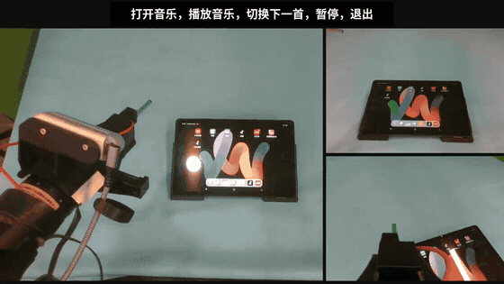
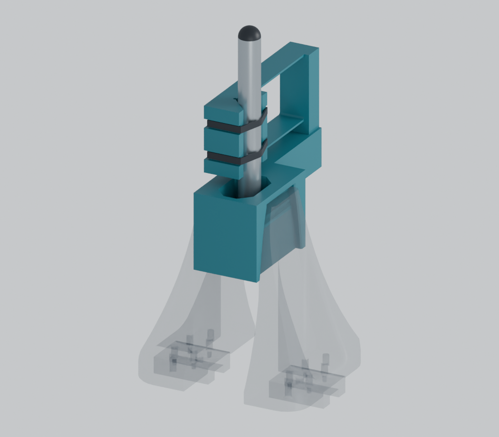
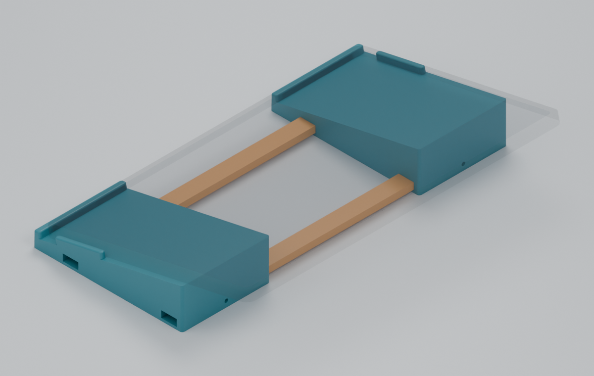

<div align="center">

# Robot-Use-Tablet (`tablet_tap`)

**A camera-only, voice- and text-controlled robotic arm system that operates an Android tablet with a 3D-printed compliant stylus — no ADB, no screen capture.**

English | [简体中文](README_CN.md) | [Full Operation Guide (中文上机手册)](docs/OPERATION_GUIDE.md)

[](https://heliang-pu.github.io/projects.html#tablet-tap)
[](#)
[](#)
[](#)
[](LICENSE)

<br>

<a href="docs/demo/tablet_tap_demo.mp4">
  
</a>

*Real-robot three-camera demo (4.5× preview; click image for full-speed 1280×720 [MP4](docs/demo/tablet_tap_demo.mp4)): spoken/typed instruction driving multi-step music playback control (open app → play → next track → pause → exit). Supports general open-ended Android tasks including tap, long-press, swipe, navigation, and on-screen keyboard typing.*

</div>

---

## System Overview

Given a spoken or typed natural-language instruction, an AgileX PiPER robotic arm holding a 3D-printed compliant capacitive stylus executes multi-step GUI interactions on an angled Android tablet using **cameras alone** (no ADB debugging and no digital screenshot API):

```text
Microphone ──► ASR (SenseVoiceSmall) ──► Natural-Language Instruction
                                                  │
Wrist Camera (1100–1300 px rectified screen,      ▼
optional two-view glare removal) ──► GUI Agent (GUI-Owl-1.5 via vLLM)
Top Camera (coarse pose + bump guard)             │
                                                  ▼
Screen Coordinates (u, v) ──► Leave-One-Out Tap-Error Correction
                          ──► Calibrated 3D Screen Plane ──► Pinocchio / URDF IK
                          ──► Hover-Safe Trajectory + Perpendicular Press ──► Park & Repeat
```

---

## Key Features

- **Camera-Only Closed Loop (No ADB)**: Runtime perception relies solely on RealSense cameras. The wrist camera captures high-resolution screen views (1100–1300 px wide) with optional **two-view complementary glare removal**, while the top camera tracks tablet pose and halts execution if the tablet shifts (`> 5 mm` or `> 1.5°`).
- **General Multi-Step GUI Control**: Supports tap, long-press, swipe, back/home navigation, and calibrated 26-key on-screen keyboard typing driven by **GUI-Owl-1.5 (8B / 2B)** and **SenseVoiceSmall** ASR.
- **Classical Kinematics & Safety Guards**: Computes forward/inverse kinematics via **Pinocchio** on a firmware-calibrated PiPER URDF; enforces hover-plane transit (`15 mm` above screen), perpendicular normal presses, per-step and velocity limits (`0.04 rad` / `1.2 rad/s`), hover collision checks, force-limited grasping (`5 N`), and emergency fault recovery.
- **Hand-Eye Calibration & Adaptive Error Compensation**: Supports checkerboard eye-to-hand calibration, 14-pose eye-in-hand wrist calibration, real-time ArUco pose tracking, and one-click automated probing with **leave-one-out model selection** (translation / linear / quadratic tap-error compensation).
- **3D-Printed Compliant Tooling**: Parametric CAD (`cad/`) for a dual-flexure compliant stylus holder (`5 mm` axial travel, `~0.4 N/mm`) and an adjustable angled tablet stand (`12°–20°`).
- **Clean Architecture, Web Console & Software Rehearsal**: Ports-and-adapters layered design enforced by `tests/test_architecture.py`; unified web console for calibration, command execution, voice input, and automatic 3-camera video recording; full-pipeline **hardware-free software rehearsal** (`tablet_tap.web.rehearsal`) with synthetic camera blur, joint backlash, and interactive UI simulation.

---

## 3D-Printed Hardware (`cad/`)

Ready-to-print STL files live in [`cad/out/stl/`](cad/out/stl/) alongside parametric generation and geometry verification scripts (`cad/build_parts.py`, `cad/check_parts.py`).

| Compliant Stylus Holder (`pen_holder.stl`) | Angled Tablet Stand (`stand_left/right.stl`, `tie_bar.stl`) |
| :---: | :---: |
|  |  |
| `75 × 62 × 26 mm`, dual `0.8 mm` flexures providing `5 mm` axial press compliance | `70 × 118 × 32 mm` supports + two `200 mm` tie bars, 12°–20° incline |

---

## Measured Benchmarks

- **Camera Calibration (Real Top Camera, 12 consecutive frames @ 72 cm)**: Checkerboard corner reprojection error **`0.11 px`**, plane-normal frame-to-frame repeatability **`0.02°`**.
- **Wrist-Camera Screen Resolution**: Rectified tablet view width **`1100–1300 px`** (vs. `~455 px` from the top camera alone), enabling reliable icon and small-text grounding.
- **GUI Agent Latency (vLLM, `--max-model-len 16384`)**:
  - `GUI-Owl-1.5-2B`: **`~0.75 s / step`** (`~9 GiB` VRAM)
  - `GUI-Owl-1.5-8B`: **`~1.5 s / step`** (`~22 GiB` VRAM)
- **Automated Offline Test Suite**: Enforces strict layered imports (`tests/test_architecture.py`), IK/trajectory safety, calibration math, error correction, keyboard typing, web API, and recording pipelines without hardware (`TABLET_TAP_NO_HARDWARE=1`).

---

## Repository Layout

```text
tablet_tap/
  cli/  web/        CLI commands (command registry) & unified web console (/console, /run, /rec, /calib)
  app.py            Dependency-injection container (AppContext) shared by CLI and web UI
  calibration/      Browser touch-calibration page, eye-to-hand / eye-in-hand calibration, auto-probe, tap correction
  agent/            Device abstraction & GUI-Owl-1.5 closed-loop agent + offline grounding evaluator
  speech/           Microphone client & SenseVoiceSmall ASR service
  robot/            ArmIO interface (PiperPenArm / FakeArm), TabletRobot facade, wrist-camera arm controller
  vision/           Camera interface (RealSense / OpenCV / file), ArUco tracking, screen rectification, glare fusion
  core/             Pure algorithms: Pinocchio IK/FK, plane fitting, trajectory planning, on-screen keyboard layout
tests/              Hardware-free unit, architecture, web, and rehearsal tests
cad/                Parametric CAD scripts, geometry checks, renders, and printable STLs (cad/out/stl/)
assets/             Firmware-calibrated CobotMagic / PiPER single-arm URDF & meshes
scripts/            Environment setup (robot / vlm / asr), vLLM & ASR launchers, CAN setup, status checks
docs/               Detailed Chinese operation manual (OPERATION_GUIDE.md), bench twin params, demo videos
```

---

## Quick Start (Try Without Hardware)

You can run the full web console, test suite, and end-to-end software rehearsal completely offline without a physical robot or GPU:

```bash
# 1. Create the robot environment (Python 3.11, Pinocchio, OpenCV+ArUco, FastAPI)
bash scripts/setup_robot_env.sh

# 2. Run the offline unit & architecture test suite
TABLET_TAP_NO_HARDWARE=1 bin/py -m pytest -q tests

# 3. Launch the interactive software rehearsal bench in your browser
bin/py -m tablet_tap.web.rehearsal --serve 8811 --llm scripted --slant 12 --park_j1 0.7

# Or launch the calibration & control web console in fake-hardware mode
bin/py -m tablet_tap.web.console --port 8801 --fake
```

For real-robot setup (vLLM model server, SenseVoiceSmall ASR server, CAN bus setup, wrist hand-eye calibration, one-click accuracy calibration, and safety procedures), see the complete step-by-step guide in [`docs/OPERATION_GUIDE.md`](docs/OPERATION_GUIDE.md).

---

## Author & Links

- **Author**: Heliang Pu ([heliang-pu.github.io](https://heliang-pu.github.io/))
- **Related Project**: [ChainPlanner (`wam-long-horizon-planner`)](https://github.com/heliang-pu/wam-long-horizon-planner) — Long-horizon 2B VLM planner on top of a frozen multi-task World Action Model.
- **License**: Released under the [MIT License](LICENSE). Third-party references retain their original notices in `third_party/`.
