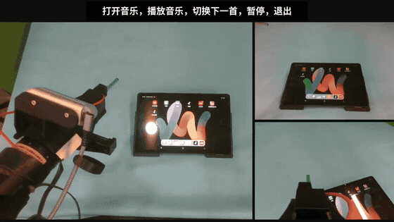
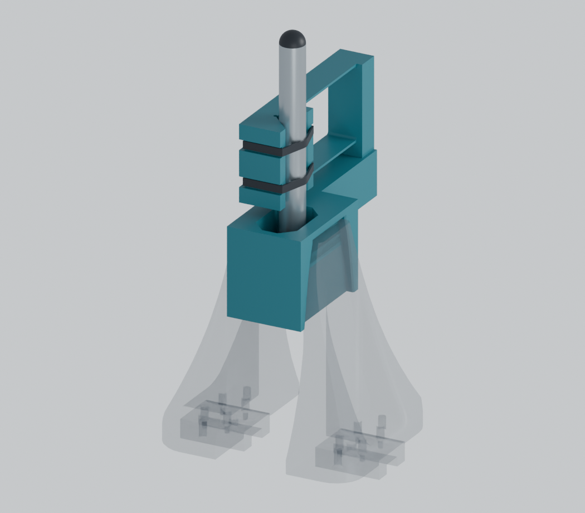
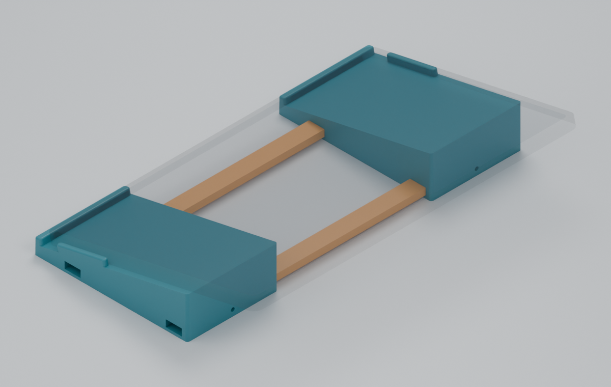

<div align="center">

# Robot-Use-Tablet（`tablet_tap`）

**说一句话或输入指令，机械臂夹持 3D 打印弹性电容笔，纯靠相机看屏操控安卓平板（无需 ADB、无需平板截屏）。**

[English](README.md) | 简体中文 | [完整上机与标定手册](docs/OPERATION_GUIDE.md)

[](https://heliang-pu.github.io/projects.html#tablet-tap)
[](#)
[](#)
[](#)
[](LICENSE)

<br>

<a href="docs/demo/tablet_tap_demo.mp4">
  
</a>

*真机三路相机演示（4.5× 动图预览；点击画面查看原速 1280×720 高清 [MP4](docs/demo/tablet_tap_demo.mp4)）：演示语音/文字指令驱动的多步音乐操作（打开音乐 → 播放 → 切歌 → 暂停 → 退出）。系统面向开放式多步安卓交互，支持点按、长按、滑动、返回/回桌面与屏幕键盘打字。*

</div>

---

## 系统闭环流程

人说一句语音或输入文字指令，松灵 PiPER 机械臂夹持 3D 打印弹性电容笔夹，在斜放的安卓平板上一步步完成操作，运行时**完全不依赖 ADB，也不从平板内部取截图**：

```text
麦克风 ──► 语音识别（SenseVoiceSmall）──► 自然语言指令
                                              │
腕部相机高清拍屏拉正（1100–1300 px，          ▼
支持双角度合成去反光） ──► GUI 智能体（vLLM 部署 GUI-Owl-1.5）
顶部相机（粗定位 + 防挪动保护）               │
                                              ▼
屏幕目标坐标 (u, v) ──► 留一法点按误差补偿
                    ──► 标定屏幕 3D 平面 ──► Pinocchio / URDF 逆运动学
                    ──► 悬停平面平移 + 法向垂直下压 ──► 回停靠位循环
```

---

## 核心工程亮点

- **纯相机闭环（零 ADB 依赖）**：腕部相机负责高分辨率看屏（屏宽 1100–1300 px），支持**双角度互补拍屏去反光**；顶部相机持续跟踪平板位姿，执行中平板被碰动超过 `5 mm` 或 `1.5°` 自动急停保护。
- **开放式多步 GUI 操作**：基于 **GUI-Owl-1.5（8B / 2B）** 与 **SenseVoiceSmall**，支持点按、长按、滑动、导航键以及标定后的 26 键拼音键盘逐键打字。
- **传统运动学与安全保护**：采用 **Pinocchio** 结合真机固件实测限位 URDF 解算正逆运动学；所有横向移动锁定在屏幕上方 `15 mm` 悬停平面，正对目标后沿法向垂直下压，并配备单步限幅（`0.04 rad`）、速度缩放（`1.2 rad/s`）、悬停碰撞检测、力控夹爪（`5 N`）与急停故障恢复。
- **手眼标定与自适应误差补偿**：支持棋盘格眼在手外标定、14 位姿眼在手上腕部标定、ArUco 实时平板位姿追踪，以及一键自动探触 + **留一法自适应阶数**（平移 / 线性 / 二次）点按误差补偿。
- **参数化 3D 打印硬件工装**：内置可 3D 打印的双簧片弹性笔夹（沿笔轴 `5 mm` 柔性缓冲行程，约 `0.4 N/mm`）与 12°–20° 可调斜角平板支架。
- **分层架构、网页控制台与离线软件排练**：采用端口与适配器 + 依赖注入分层设计，由 `tests/test_architecture.py` 自动校验依赖方向；配套一体化网页控制台（标定、语音/文字指令执行、三路相机自动录像）和无需硬件即可验证全链路的**离线软件排练台架**（`tablet_tap.web.rehearsal`）。

---

## 3D 打印硬件工装（`cad/`）

可直接打印的 STL 模型位于 [`cad/out/stl/`](cad/out/stl/)，配套参数化建模与几何验收脚本（`cad/build_parts.py`、`cad/check_parts.py`）：

| 弹性电容笔夹（`pen_holder.stl`） | 斜角平板支架（`stand_left/right.stl`、`tie_bar.stl`） |
| :---: | :---: |
|  |  |
| `75 × 62 × 26 mm`，双 `0.8 mm` 簧片提供 `5 mm` 轴向弹性行程 | `70 × 118 × 32 mm` 双托座 + 两根 `200 mm` 连杆，12°–20° 倾角 |

---

## 实测数据

- **相机标定实测（顶部相机真实画面，72 cm 距离连续 12 帧）**：棋盘格角点重投影误差 **`0.11 px`**，板面法线帧间重复性 **`0.02°`**。
- **腕部看屏清晰度**：矫正后屏幕宽度 **`1100–1300 px`**（单用顶部相机约 `455 px`），大幅提升小图标与文字定位能力。
- **GUI Agent 推理速度（vLLM，`--max-model-len 16384`）**：
  - `GUI-Owl-1.5-2B`：**约 `0.75 秒 / 步`**（约 `9 GiB` 显存）
  - `GUI-Owl-1.5-8B`：**约 `1.5 秒 / 步`**（约 `22 GiB` 显存）

---

## 无硬件快速体验

不连机械臂、不占显卡，即可在本地跑通单测、网页控制台与全流程软件排练：

```bash
# 1. 创建机器人侧 Python 环境
bash scripts/setup_robot_env.sh

# 2. 运行离线单元测试与分层架构检查
TABLET_TAP_NO_HARDWARE=1 bin/py -m pytest -q tests

# 3. 启动浏览器交互式全流程软件排练台架
bin/py -m tablet_tap.web.rehearsal --serve 8811 --llm scripted --slant 12 --park_j1 0.7

# 或以纯软件模拟模式启动网页标定与操控台
bin/py -m tablet_tap.web.console --port 8801 --fake
```

完整的真机部署、手眼标定、一键精度校准、双角度去反光与故障恢复步骤，请查阅 **[完整上机与标定手册（`docs/OPERATION_GUIDE.md`）](docs/OPERATION_GUIDE.md)**。

---

## 作者与相关链接

- **作者主页**：[蒲贺良（heliang-pu.github.io）](https://heliang-pu.github.io/)
- **相关开源项目**：[ChainPlanner（`wam-long-horizon-planner`）](https://github.com/heliang-pu/wam-long-horizon-planner) —— 冻结多任务世界动作模型（Phoenix-MWA）之上的 2B VLM 长时程任务规划器。
- **开源协议**：[MIT License](LICENSE)
